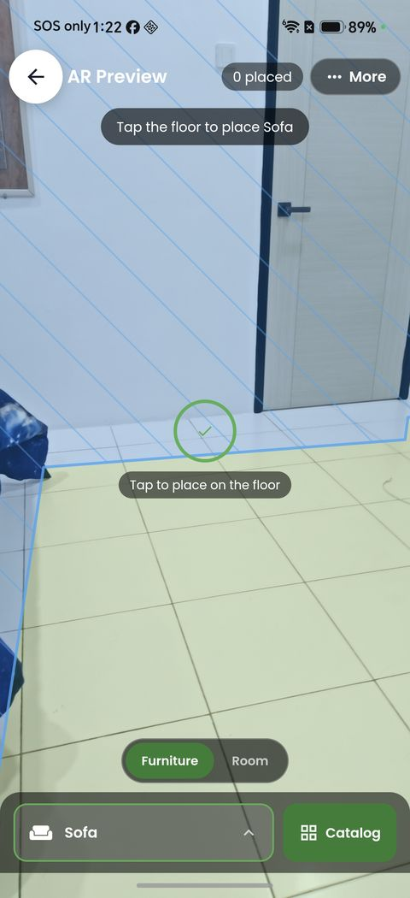
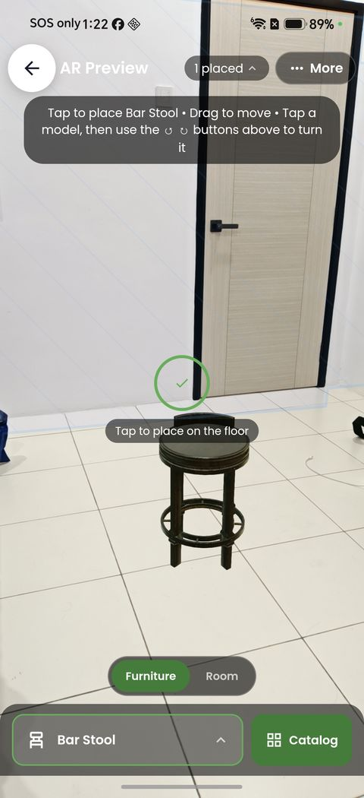
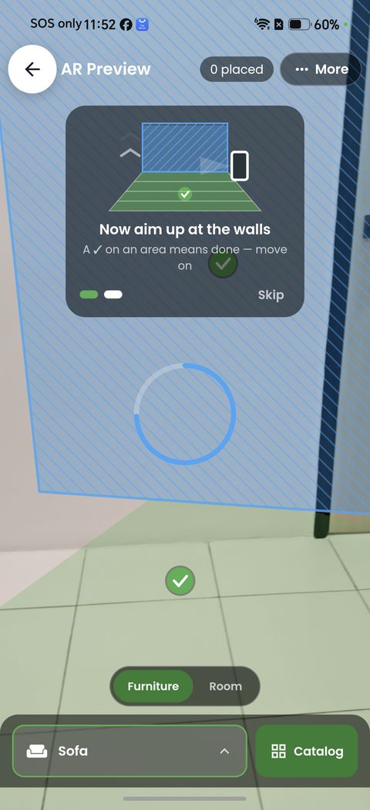
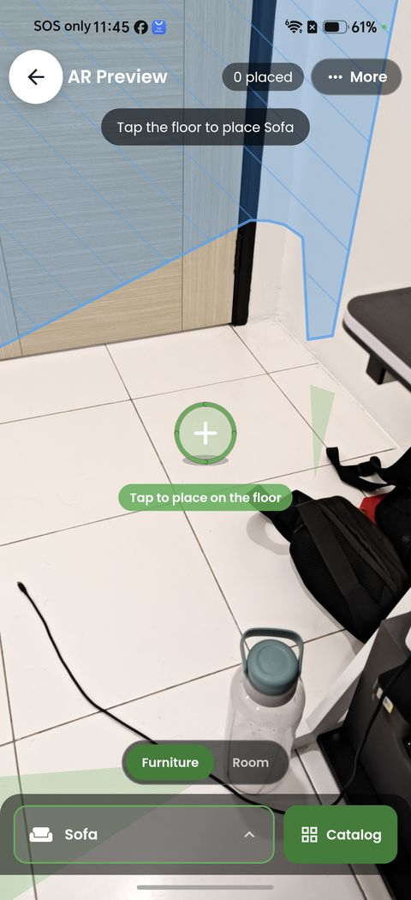
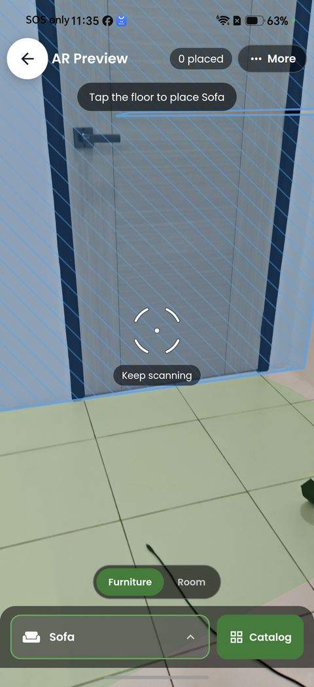

# Intellar — AI interior design & furniture marketplace

Intellar is an Android app that helps homeowners plan a room and buy the furniture for it in one place.
You can place real-size furniture in your room with **augmented reality (AR)**, lay out a room in a **3D planner**,
walk through it, ask an **AI design assistant** for ideas, and buy from local sellers in the built-in
**marketplace**. Sellers manage their listings and sales in the same app, and an **admin web console**
looks after accounts, seller verification and platform revenue.

> Final-year project (BACS3403). Android only. Payments run in **Stripe test mode** — no real money is charged.

---

## Screenshots

Real captures from an Android phone (Honor), in a room with plain white walls and glossy floor tiles.

| Floor and walls detected | Furniture placed at true size | Scanning guide |
|:---:|:---:|:---:|
|  |  |  |
| Green floor, blue hatched walls | A catalogue bar stool on the real floor | Step 2 of the guide: a ✓ marks each finished area |

| Ready to place | Wall fitted to the door | Full-screen product photo |
|:---:|:---:|:---:|
|  |  |  |
| The target turns green when a tap will work | The painted wall sits on the door's base | Pinch or double-tap to zoom |

---

## Download

Get the latest APK from the **[Releases](../../releases)** page.

| File | Use it when |
|---|---|
| `Intellar-vX.Y.Z-arm64-v8a.apk` | Almost every phone from the last 6+ years (smaller download) |
| `Intellar-vX.Y.Z-universal.apk` | Not sure which one — works on any supported phone |

**Requirements**
- Android 9 (API 28) or newer
- For the AR view: a phone that supports [Google Play Services for AR (ARCore)](https://developers.google.com/ar/devices)
- Internet connection (accounts, marketplace and AI features run online)

**Install**
1. Download the APK on your phone.
2. Open it. If asked, allow your browser or file manager to *install unknown apps*.
3. Tap **Install**, then open **Intellar**.
4. Sign up as a homeowner or a seller, or tap **Explore as a guest** to look around first.

---

## Features

### For homeowners
- **AR view (true size).** Point the camera at your floor and walls; the floor is shaded green, walls blue.
  Tap to place catalogue or marketplace furniture at its real size. Drag, rotate or remove items, and save
  photos of the view. A first-visit guide shows how to scan the floor and walls, and a ✓ marks each area
  that is done.
- **Room finishes.** Preview floor and wall finishes (wood, tiles, paint, brick…) on your real room.
- **Room planner (3D).** Set the room size or draw walls, add furniture from the catalogue or the
  marketplace, and save designs. "Scan room" reads the floor, walls and furniture from one photo.
- **Walkthrough & showroom.** Walk through your design in first person, or explore ready-made showroom rooms.
- **AI design assistant.** Chat about styles, colours and layouts; it suggests products from the live
  marketplace.
- **Marketplace.** Browse by category and style, view full-screen product photos with zoom, add to the cart,
  and check out with Stripe (test mode). Orders are collected from the seller (self-collection).
- **Budget planner, reports and share links.** Track spending, export a PDF design report, and share a
  3D view of a design with a link.

### For sellers
- List products with photos, price, stock, size and style.
- Optional **3D model generation** from the product photo (so buyers can place it in AR).
- Automatic **photo check**: if the photo does not seem to match the listing, the seller and buyers see a notice.
- Sales, orders and analytics; two-step sign-in with an emailed code (on by default).

### Admin console (web)
- Monitor customers and sellers, verify sellers, fix a wrong account role, and handle password help.
- Review flagged product photos.
- Platform revenue from a per-order commission (rates are stored on each order, so changing them never
  rewrites past receipts).

---

## How the AR stays accurate

ARCore's raw planes are noisy, especially on plain white walls and glossy tiles. On top of ARCore, the app:

- re-fits planes from the camera's depth points (RANSAC + least squares) and fits walls ARCore never reports;
- remembers each plane across frames, tells floor from tables by camera height, and keeps the floor height
  steady on reflective floors;
- squares walls to the room, merges wall pieces, locks them in place, and still lets a wall correct itself
  when the evidence consistently disagrees;
- trims the floor at the walls, and starts fresh if ARCore loses tracking.

Each change was measured on a real phone with recorded scans. Holding the phone steady about 1.5 m from a wall,
the painted wall stays within about 0–3 cm of the measured surface; during a normal moving scan the median is
about 5–8 cm.

---

## Tech stack

| Part | Built with |
|---|---|
| Mobile app | Flutter (Dart), Riverpod, go_router |
| AR | ARCore via a modified `ar_flutter_plugin_2` (Kotlin) + SceneView / Filament |
| 3D planner & walkthrough | Filament (native), glTF/GLB models |
| Backend API | Node.js + Express + TypeScript, firebase-admin |
| Admin console | React + Vite + TypeScript |
| Data & auth | Firebase Authentication, Cloud Firestore, Firebase Cloud Messaging |
| Payments | Stripe (test mode) |
| AI | Google Gemini (design assistant, room scan, photo checks) and Tripo (3D models), both called only from the backend |
| Hosting | Render (backend + admin console), Supabase Storage (3D models) |

---

## Repository layout

```
lib/                     Flutter app
  features/customer/     homeowner features (AR, planner, walkthrough, marketplace, AI…)
  features/supplier/     seller features
  features/auth/         sign-in, registration, guest mode, two-step sign-in
  shared/  core/  models/  services/
packages/ar_flutter_plugin_2/   modified AR plugin (Android / Kotlin)
assets/models/           furniture 3D models (see assets/models/CREDITS.md)
web/backend/             Node + Express API (admin API, AI and 3D proxies, payments, notifications)
web/frontend/            React admin console (served at /admin)
test/                    Flutter tests
firestore.rules          Firestore security rules
```

---

## Run it yourself (developers)

### Prerequisites
- Flutter (stable, Dart ≥ 3.7) and Android Studio / Android SDK
- A Firebase project with Authentication (Email/Password + Anonymous) and Firestore enabled
- Node.js 20+ for the backend and admin console

### Mobile app
```bash
flutter pub get
# Put your Firebase config in place: android/app/google-services.json and lib/firebase_options.dart
flutter run \
  --dart-define=MARKETPLACE_API_URL=https://your-backend.example.com \
  --dart-define=VERIFICATION_API_URL=https://your-backend.example.com
```
Build an installable APK:
```bash
flutter build apk --release --split-per-abi   # smaller per-CPU APKs
flutter build apk --release                   # one universal APK
```

### Backend and admin console
```bash
cd web/backend
cp .env.example .env     # fill in the values (see below)
npm install
npm run dev              # API on http://localhost:4000

cd ../frontend
npm install
npm run dev              # admin console on http://localhost:5173/admin/
```
Backend settings (`web/backend/.env`): `FIREBASE_PROJECT_ID`, `FIREBASE_WEB_API_KEY`, `ADMIN_UIDS`,
a service account (`SERVICE_ACCOUNT_PATH` or `FIREBASE_SERVICE_ACCOUNT_JSON`), `GEMINI_API_KEY`,
`TRIPO_API_KEY`, `STRIPE_SECRET_KEY`, `STRIPE_PUBLISHABLE_KEY`, `STRIPE_WEBHOOK_SECRET`, and for 3D model
storage `SUPABASE_URL` and `SUPABASE_SERVICE_ROLE_KEY`. Deployment notes are in [`web/README.md`](web/README.md).

### Tests
```bash
flutter test                       # app tests
cd web/backend && npm test         # backend tests
```

---

## Security notes
- **No third-party API keys are in the app.** Gemini, Tripo, Stripe secret and Supabase keys live only on
  the backend; the app calls the backend with the user's Firebase sign-in.
- Money fields on orders are written by the server, not the app.
- Guests can browse, but must create an account to buy, sell or save.

---

## Credits
- Furniture models from [Poly Haven](https://polyhaven.com) (CC0), the
  [Khronos glTF Sample Assets](https://github.com/KhronosGroup/glTF-Sample-Assets) and
  [OpenGameArt](https://opengameart.org) — full list in [`assets/models/CREDITS.md`](assets/models/CREDITS.md).

Made by [YHang777](https://github.com/YHang777) as a final-year project.
